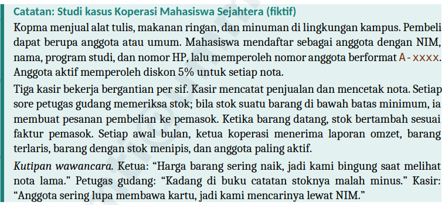
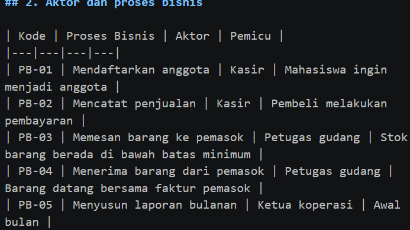
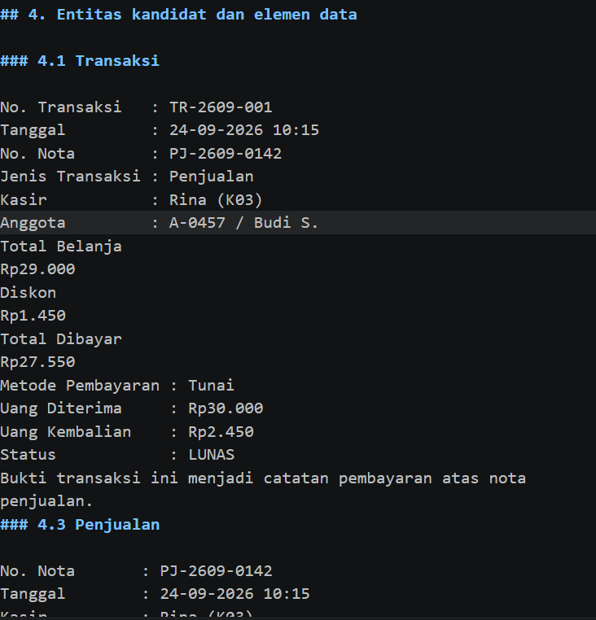
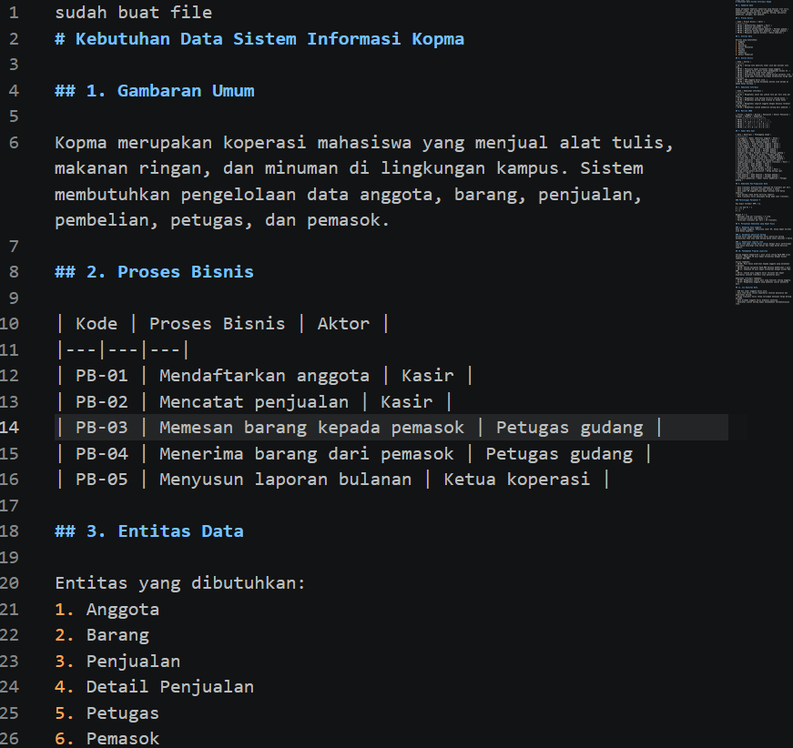
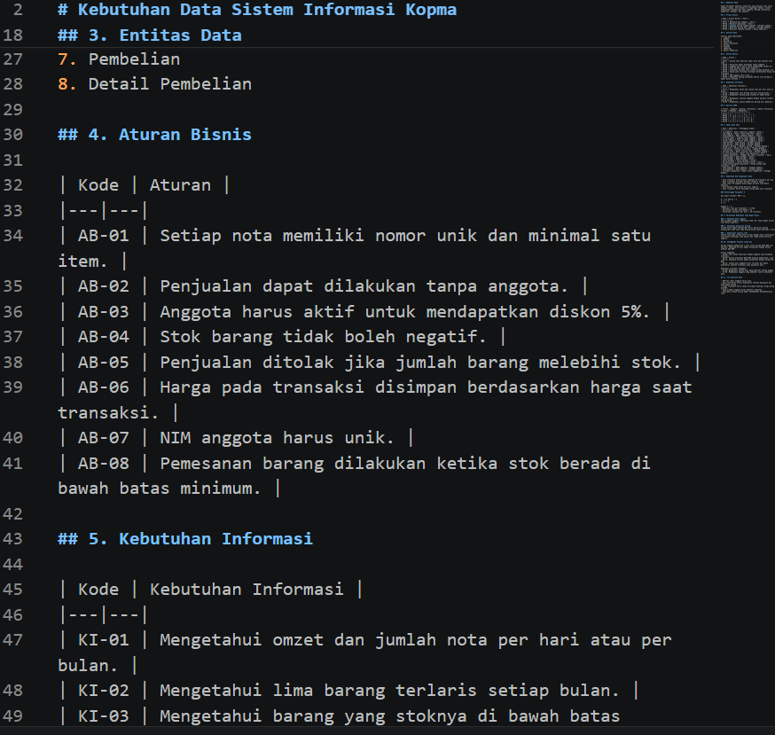
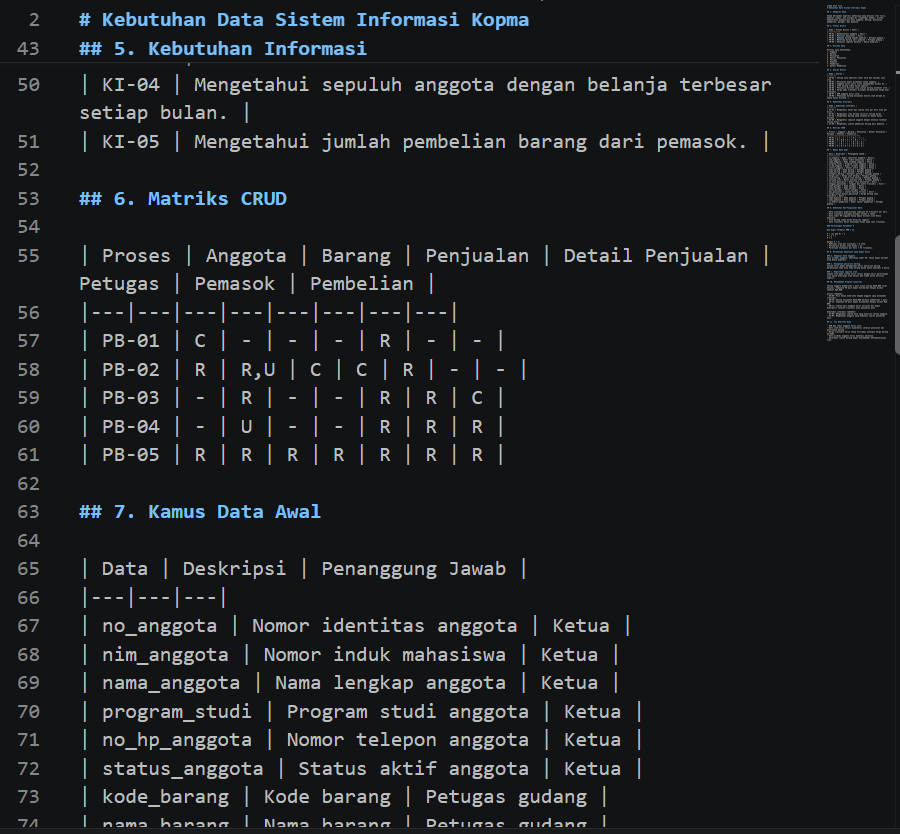
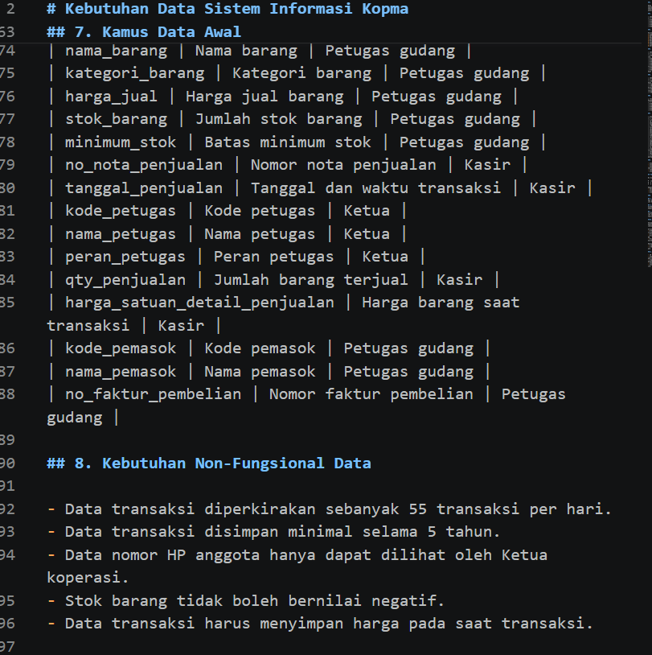
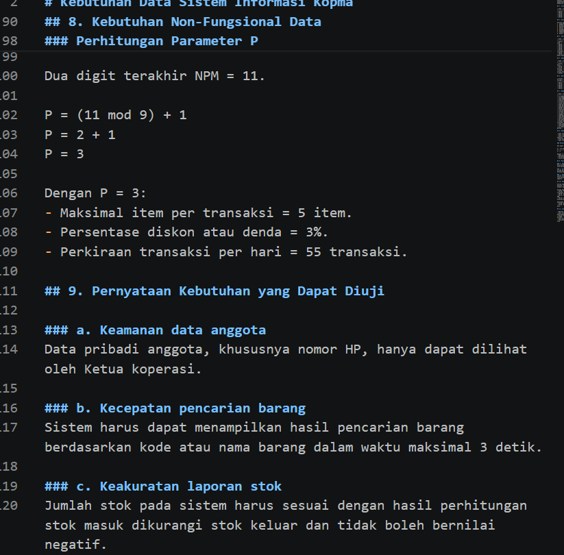
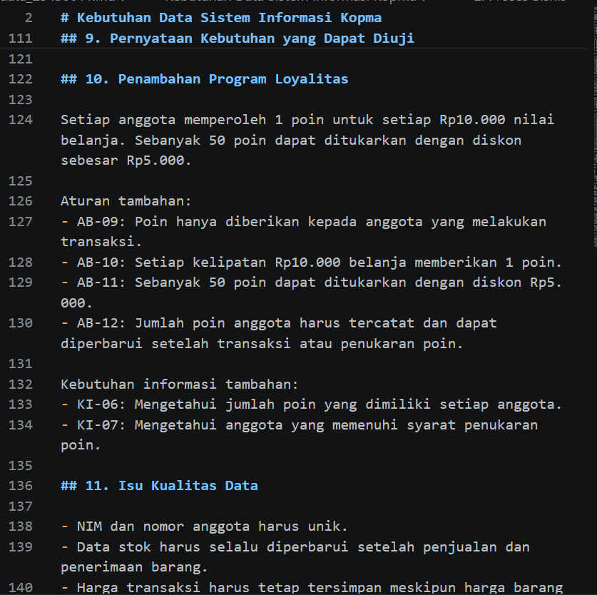
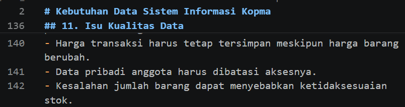

# LAPORAN PRAKTIKUM BASIS DATA – PERTEMUAN NN

**Nama:** Windi Dwi Hartati  
**NIM:** 25430011  
**Kelas:** A
**Tanggal:** 7 OKTOBER 2026

## 1. Tujuan Praktikum
Setelah menyelesaikan praktikum Modul 2, mahasiswa mampu:
1. Mengidentifikasi aktivitas organisasi, aktor, dan proses bisnis berdasarkan narasi, wawancara, dan dokumen sumber.
2. Mengidentifikasi elemen data, entitas kandidat, dan aturan bisnis yang dibutuhkan berdasarkan dokumen sumber.
3. Menyusun matriks proses–data (CRUD) dan kamus data awal yang dilengkapi dengan penanggung jawab data.
4. Menyusun kebutuhan data dan kebutuhan informasi yang spesifik, jelas, dan dapat diuji.

## 2. Ringkasan Dasar Teori
Modul 2 membahas analisis kebutuhan pengelolaan data berdasarkan proses bisnis organisasi. Analisis dilakukan dengan mengidentifikasi aktor, proses bisnis, entitas, elemen data, aturan bisnis, dan kebutuhan informasi.
Hasil analisis kemudian disusun dalam matriks CRUD dan kamus data. Selain itu, diperhatikan juga kebutuhan volume data, retensi, privasi, serta kualitas data. Hasil Modul 2 menjadi dasar untuk pemodelan data pada modul berikutnya.
## 3. Hasil Langkah Percobaan
### D.1 Membaca study kasus 

### D.2 Mengidentifikasi Aktor Dan Proses Bisnis 

## D.3 Membedah Dokumen Sumber

## 4. Jawaban Titik Analisis
Titik Analisis 1:
Harga saat transaksi perlu disimpan karena harga barang dapat berubah. Dengan begitu, koperasi tetap mengetahui harga yang berlaku saat transaksi sesuai keluhan ketua koperasi..
Titik Analisis 2:
-- Tidak disimpan: Subtotal dan total dapat dihitung otomatis dari harga dan jumlah barang.
- Tetap disimpan: Total memudahkan pencatatan dan pemeriksaan pembayaran transaksi.
## 5. Hasil Latihan dan Modifikasi
Jelaskan hasil latihan yang dikerjakan serta perubahan atau modifikasi yang dilakukan selama praktikum.

## 6. Tugas Mandiri: Milestone Proyek NN

## 7. Pembahasan dan Kendala
Hasil Praktikum:
Praktikum berhasil memahami struktur nota pembelian, penjualan, dan transaksi serta membedakan data utama dan nilai turunan.
Kendala:
Kesulitan membedakan data yang perlu disimpan dan data yang dapat dihitung otomatis.
Penyebab Kendala:
Belum memahami sepenuhnya konsep penyimpanan data dalam basis data.
Cara Mengatasinya:
Mempelajari kembali materi dan menganalisis setiap bagian nota untuk menentukan data yang perlu disimpan atau dihitung otomatis.
## 8. Kesimpulan
Praktikum ini membantu memahami struktur nota pembelian, penjualan, dan transaksi serta pentingnya menyimpan data dengan benar. Data harga saat transaksi perlu disimpan, sedangkan subtotal dan total dapat dihitung otomatis untuk menjaga keakuratan data.
## 9. Pernyataan Penggunaan AI
Saya menggunakan AI sebagai alat bantu untuk memahami materi praktikum, menyusun jawaban titik analisis, dan merapikan penulisan laporan. Namun, saya tetap mempelajari materi dan menyesuaikan jawaban dengan tugas praktikum yang dikerjakan.

## 10. Bukti Git
**Tautan repositori GitHub:** …………………………………  
**Hash commit:** …………………………………

## Checklist
Salin checklist yang terdapat pada buku atau modul praktikum sesuai petunjuk dosen.