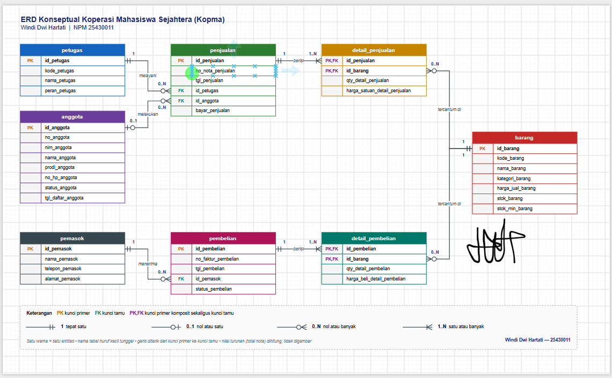
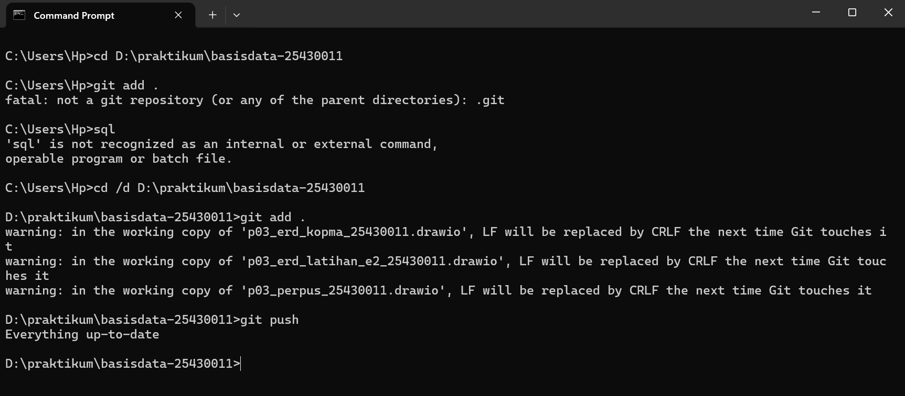
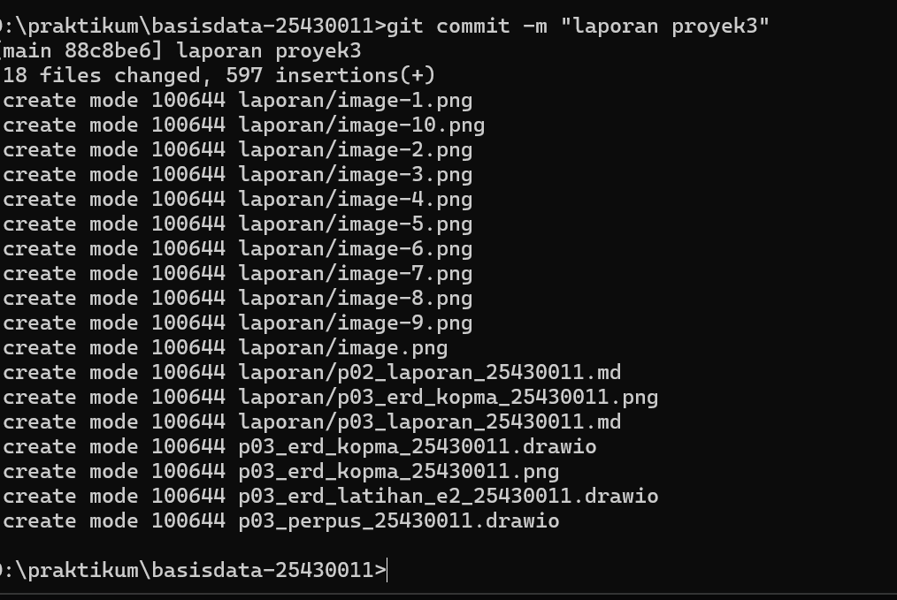

# LAPORAN PRAKTIKUM BASIS DATA – PERTEMUAN NN

**Nama:** Windi Dwi Hartati  
**NIM:** 25430011  
**Kelas:** A 
**Tanggal:** 13 Oktober 2026

## 1. Tujuan Praktikum
Tujuan praktikum Modul 3 adalah memahami pemodelan data menggunakan Entity-Relationship Diagram (ERD), mengidentifikasi entitas dan atribut, menentukan hubungan serta kardinalitas ant entitas, dan menyusun ERD proyek perpustakaan berdasarkan kebutuhan data yang telah dianalisis pada Pertemuan 2.

## 2. Ringkasan Dasar Teori
Entity-Relationship Diagram (ERD) merupakan diagram yang digunakan untuk menggambarkan entitas, atribut, dan hubungan ant entitas dalam suatu sistem basis data. Entitas mewakili objek yang datanya dikelola, sedangkan atribut menjelaskan karakteristik entitas tersebut.

Relasi menunjukkan hubungan antar entitas, sementara kardinalitas menjelaskan jumlah keterhubungan ant entitas, seperti satu-ke-satu, satu-ke-banyak, atau banyak-ke-banyak. ERD membantu memastikan kebutuhan informasi dapat dipenuhi melalui struktur data yang dirancang sebelum masuk ke tahap normalisasi dan pembuatan tabel.

## 3. Hasil Langkah Percobaan
## 4. Entitas Kandidat dan Elemen Data

### D.1 Dari Entitas Kandidat ke Entitas
| Entitas | Atribut Kunci (PK) | Kunci Alternatif (AK) | Atribut Turunan |
| Anggota | nomor_anggota | NIM | - |
| Barang | kode_barang | - | - |
| Penjualan | no_nota_penjualan | - | total, subtotal, kembalian |
| Detail_penjualan | no_nota_penjualan + kode_barang | - | subtotal |
| Petugas | kode_petugas | - | - |
| Pemasok | kode_pemasok | - | - |
| Pembelian | no_faktur_pembelian | - | total_pembelian |
| Detail_pembelian | no_faktur_pembelian + kode_barang | - | subtotal_pembelian |
Keterangan:
- atribut yang menjadi identitas unik setiap data.
- atribut alternatif yang juga harus unik, contohnya NIM anggota.
- atribut yang nilainya dapat dihitung dari atribut lain.
2. Memecah entitas Pembelian dan detailnya
Entitas Pembelian dan detailnya dipecah menjadi dua entitas, yaitu Pembelian dan Detail_Pembelian, dengan pola yang sama seperti Penjualan.
Entitas Pembelian
| Atribut | Keterangan |
| no_faktur_pembelian | Primary Key |
| tanggal_pembelian | Tanggal pembelian |
| kode_pemasok | Foreign Key |
| kode_petugas | Foreign Key |

Entitas Detail_Pembelian
| Atribut | Keterangan |
| no_faktur_pembelian | Primary Key dan Foreign Key |
| kode_barang | Primary Key dan Foreign Key |
| qty | Jumlah barang yang dibeli |
| harga_beli | Harga barang saat pembelian |
| subtotal_pembelian | Qty × harga_beli |
Dengan pemisahan ini, satu transaksi pembelian dapat memiliki banyak detail barang. Data pemasok dan tanggal disimpan pada entitas Pembelian, sedangkan jumlah dan harga masing-masing barang disimpan pada Detail_Pembelian.
### D.2 Perencanaan Relasi Dan Kardinalitas
No.	|Relasi|	|Kalimat Relasi|	|Kardinalitas|
1	|Anggota – Penjualan||Anggota melakukan penjualan.|	|Anggota: 0..N, Penjualan: 0..1|
2	|Petugas – Penjualan||Petugas melayani penjualan.||Petugas: 0..N, Penjualan: 1..1|
3	|Penjualan – Detail Penjualan||Penjualan memiliki detail penjualan.||Penjualan: 1..N, Detail: 1..1|
4	|Barang – Detail Penjualan||Barang tercatat dalam detail penjualan.||Barang: 0..N, Detail: 1..1|
5	|Pemasok – Pembelian||Pemasok menyediakan pembelian barang.||Pemasok: 0..N, Pembelian: 1..1|
6	|Petugas – Pembelian||Petugas mencatat pembelian.||Petugas: 0..N, Pembelian: 1..1|
7	|Pembelian – Detail Pembelian||Pembelian memiliki detail pembelian.||Pembelian: 1..N, Detail: 1..1|
8	|Barang – Detail Pembelian||Barang tercatat dalam detail pembelian.||Barang: 0..N, Detail: 1..1|
Keterangan kardinalitas: 0..N berarti boleh tidak ada atau banyak, 0..1 berarti opsional maksimal satu, 1..1 berarti wajib tepat satu, dan 1..N berarti minimal satu dan bisa banyak.
Tabel Relasi, Kardinalitas, dan Aturan Bisnis
|Kode|	|Relasi|	|Aturan Bisnis|
|RB-01|	Anggota – Penjualan|	Satu anggota dapat melakukan banyak penjualan, tetapi satu penjualan hanya dapat terkait dengan maksimal satu anggota. Anggota pada penjualan bersifat opsional.|
|RB-02|	Petugas – Penjualan|	Satu petugas dapat melayani banyak penjualan. Setiap penjualan dilayani satu petugas.|
|RB-03|	Penjualan – Detail Penjualan|	Satu penjualan memiliki satu atau lebih detail barang. Setiap detail hanya milik satu penjualan.|
|RB-04|	Barang – Detail Penjualan|	Satu barang dapat muncul pada banyak detail penjualan. Setiap detail mengacu pada satu barang.|
|RB-05|	Pemasok – Pembelian|	Satu pemasok dapat memiliki banyak transaksi pembelian. Setiap pembelian berasal dari satu pemasok.|
|RB-06|	Petugas – Pembelian|	Satu petugas dapat mencatat banyak pembelian. Setiap pembelian dicatat oleh satu petugas.|
|RB-07|	Pembelian – Detail Pembelian|	Satu pembelian memiliki satu atau lebih detail barang. Setiap detail hanya milik satu pembelian.|
|RB-08|	Barang – Detail Pembelian|	Satu barang dapat muncul pada banyak detail pembelian. Setiap detail mengacu pada satu barang.|
# D.3 menggambar EDY
screenshot drawio: 
# D. 4 # Validasi ERD Kopma terhadap Kebutuhan Informasi (KI)

Nama: Windi Dwi Hartati
NPM: 25430011
Berkas ERD: `p03_erd_kopma_25430011.drawio` / `.png`

## 1. Penelusuran KI → jalur ERD

| KI | Kebutuhan informasi | Jalur di ERD | Atribut yang dipakai | Hasil |
|----|---------------------|--------------|----------------------|-------|
| KI-01 | Omzet dan jumlah nota per hari dan per bulan | penjualan → detail_penjualan | `tgl_penjualan` (dikelompokkan per tanggal/bulan), `qty_detail_penjualan` × `harga_satuan_detail_penjualan` (omzet), jumlah baris `penjualan` (jumlah nota) | Tertelusuri |
| KI-02 | Lima barang terlaris per bulan berdasarkan qty | barang ← detail_penjualan ← penjualan | `nama_barang`, `qty_detail_penjualan` (dijumlahkan), `tgl_penjualan` (untuk bulan) | Tertelusuri |
| KI-03 | Barang dengan stok di bawah batas minimum | barang (satu entitas) | `stok_barang` dibandingkan dengan `stok_min_barang` | Tertelusuri |
| KI-04 | Sepuluh anggota dengan belanja terbesar per bulan | anggota → penjualan → detail_penjualan | `nama_anggota`, `tgl_penjualan` (bulan), `qty_detail_penjualan` × `harga_satuan_detail_penjualan` | Tertelusuri |

### Catatan penelusuran
- **KI-01.** Omzet tidak disimpan sebagai kolom. Nilainya dihitung dari qty × harga saat transaksi. Karena itu `harga_satuan_detail_penjualan` wajib ada di detail_penjualan (AB-04).
- **KI-02.** Tabel kebutuhan informasi di Modul 2 hanya menyebut "detail penjualan, barang". Kata "per bulan" ternyata membutuhkan `tgl_penjualan`, sehingga jalurnya melewati penjualan juga. ERD sudah mencakupnya, jadi tidak ada entitas atau atribut yang kurang.
- **KI-03.** Cukup satu entitas, karena kedua kolom pembandingnya ada di barang (AB-06).
- **KI-04.** Penjualan dengan `id_anggota` kosong (pembeli umum, AB-02) tidak ikut terhitung. Itu memang yang diinginkan, karena KI-04 hanya membahas anggota.

## 2. Kesimpulan langkah 8
Seluruh KI (KI-01 sampai KI-04) dapat ditelusuri di ERD. Tidak ada entitas, atribut, atau relasi yang perlu ditambahkan.

## 3. Catatan tinjauan klien
Peninjau: <nama teman sebangku> (berperan sebagai ketua Kopma)
Tanggal: <tanggal tinjauan>

| No | Umpan balik | Keputusan | Alasan |
|----|-------------|-----------|--------|
| 1 | <isi umpan balik> | Diterima / Ditolak | <alasan> |
| 2 | <isi umpan balik> | Diterima / Ditolak | <alasan> |

## 4. Jawaban Titik Analisis
1. no_anggota dan nim_anggota sama-sama unik. Mengapa buku ini tetap memakai id_anggota sebagai kunci primer? Sebutkan satu risiko jika NIM dijadikan kunci primer?Karena id_anggota lebih stabil dan tidak berubah meskipun NIM atau nomor anggota berubah. Risikonya, jika NIM dijadikan kunci primer lalu NIM berubah, data yang terhubung di tabel lain harus diperbarui.2
2. Sisi penjualan terhadap detail_penjualan bernilai satu atau banyak, bukan nol atau banyak. Aturan bisnis mana yang memaksanya? Apakah aturan "minimal satu" ini dapat dijaga oleh struktur tabel saja? Simpan jawaban Anda; Modul 14 akan menjawabnya dengan transaksi?
Setiap penjualan harus memiliki minimal satu detail barang yang dibeli. Aturan ini menjaga agar transaksi tidak kosong. Struktur tabel saja tidak cukup untuk menjamin minimal satu detail, sehingga perlu menggunakan transaksi seperti yang akan dibahas pada Modul 14.
3. Ketua ingin mengetahui "petugas gudang mana yang menerima barang dari pemasok". Apakah ERD saat ini dapat menjawabnya? Jika belum, relasi apa yang perlu ditambahkan, dan apakah keputusan itu perlu dicatat sebagai aturan bisnis baru?Belum bisa, karena ERD saat ini belum menghubungkan petugas dengan pembelian. Perlu ditambahkan relasi antara petugas dan pembelian untuk mencatat petugas gudang yang menerima barang. Keputusan ini perlu dicatat sebagai aturan bisnis baru agar setiap penerimaan barang memiliki petugas yang bertanggung jawab.
## 5. Hasil Latihan dan Modifikasi
1. (poin loyalitas, hanya tertulis, tanpa gambar)
Keputusannya: poin dibuat sebagai entitas riwayat_poin, bukan satu atribut di anggota. Alasan utamanya:
Poin berubah dua arah, bertambah saat belanja dan berkurang saat ditukar. Satu atribut hanya menyimpan angka akhir, jadi tidak bisa dilacak dari nota mana poin berasal.
Saldo poin bisa dihitung dari riwayatnya. Buku ini memutuskan nilai turunan dihitung, bukan disimpan.
Satu anggota punya banyak kejadian poin, jadi relasinya satu-ke-banyak dan butuh entitas sendiri.Entitas riwayat_poin belum saya gambar ke ERD utama karena kamu hanya minta gambar untuk nomor 2. Kalau dosenmu minta ERD-nya ikut diperbarui, bilang saja.
E.2 (penjualan–barang banyak-ke-banyak langsung)
Di gambar, kotak merah menunjukkan data yang hilang:
qty_detail_penjualan: jumlah barang per nota tidak punya tempat.
harga_satuan_detail_penjualan: yang tersisa hanya harga barang saat ini, jadi harga di nota lama ikut berubah dan AB-04 terlanggar.
Akibatnya KI-01 (omzet), KI-02 (barang terlaris), dan KI-04 (belanja anggota) tidak bisa dihitung. Dua atribut itu milik hubungan nota dan barang, sehingga entitas asosiatif detail_penjualan memang diperlukan.
link drawio [text](../p03_erd_latihan_e2_25430011.drawio)

## 6. Tugas Mandiri: Milestone Proyek NN
## E.1  gambar erdy
[text](../p03_perpus_25430011.drawio)
## E.2 Tabel Dan Kardinalitas Perpustakaan 
|No.|	|Relasi entitas|	|Kardinalitas|
|1|	|Anggota — Penjualan|	|0..N : 0..1|
|2| |Petugas — Penjualan|	|0..N : 1|
|3|	|Petugas — Pembelian|	|0..N : 1|
|4|	|Pemasok — Pembelian|	|0..N : 1|
|5|	|Penjualan — Detail Penjualan|	|1..5 : 1|
|6|	|Barang — Detail Penjualan|	|0..N : 1|
|7|	|Pembelian — Detail Pembelian|	|1..N : 1|
|8|	|Barang — Detail Pembelian|	|0..N : 1|
## E.3 Tabel Penelusuran Hi
|Kode KI|	|Kebutuhan informasi|	|Jalur ERD|
|KI-01|	|Omzet dan jumlah nota|	|Penjualan → Detail Penjualan|
|KI-02|	|Lima barang terlaris per bulan| |Penjualan → Detail Penjualan → Barang|
|KI-03|	|Stok di bawah batas minimum| |Barang|
|KI-04|	|Sepuluh anggota dengan belanja terbesar| |Anggota → Penjualan → Detail Penjualan|
|KI-05| |Jumlah pembelian dari pemasok|	|Pemasok → Pembelian → Detail Pembelian → Barang|
|KI-06|	|Jumlah poin setiap anggota	Anggota|
|KI-07|	|Anggota yang memenuhi syarat penukaran poin| |Anggota|
## E.4 Asosiatif
# 4. Entitas Asosiatif dengan Atribut Sendiri
Berdasarkan rancangan ERD Sistem Informasi Kopma, terdapat dua entitas asosiatif, yaitu Detail Penjualan dan Detail Pembelian. Kedua entitas tersebut menghubungkan entitas transaksi dengan entitas Barang serta memiliki atribut sendiri.
A. Detail Penjualan
Detail Penjualan merupakan entitas asosiatif yang menghubungkan entitas Penjualan dengan Barang. Entitas ini digunakan untuk mencatat setiap barang yang terdapat dalam suatu nota penjualan.
Atribut yang dimiliki Detail Penjualan adalah:
- `no_nota_penjualan` sebagai foreign key ke entitas Penjualan.
- `kode_barang` sebagai foreign key ke entitas Barang.
- `qty_penjualan` untuk menyimpan jumlah barang yang terjual.
- `harga_satuan_detail_penjualan` untuk menyimpan harga barang saat transaksi berlangsung.
Atribut `no_nota_penjualan` dan `kode_barang` dapat digunakan sebagai kunci utama gabungan. Penyimpanan harga pada saat transaksi sesuai dengan Aturan Bisnis AB-06, sehingga perubahan harga barang tidak mengubah catatan transaksi sebelumnya.
B. Detail Pembelian
Detail Pembelian merupakan entitas asosiatif yang menghubungkan entitas Pembelian dengan Barang. Entitas ini digunakan untuk mencatat barang yang dibeli dalam setiap transaksi pembelian.
Atribut yang dimiliki Detail Pembelian adalah:
- `no_faktur_pembelian` sebagai foreign key ke entitas Pembelian.
- `kode_barang` sebagai foreign key ke entitas Barang.
- `qty_pembelian` untuk menyimpan jumlah barang yang dibeli.
- `harga_satuan_pembelian` untuk menyimpan harga barang per unit pada saat pembelian.
Atribut `no_faktur_pembelian` dan `kode_barang` dapat digunakan sebagai kunci utama gabungan. Atribut kuantitas dan harga satuan merupakan usulan desain untuk mendukung pencatatan pembelian serta laporan jumlah pembelian dari pemasok.
Persyaratan minimal satu entitas asosiatif dengan atribut sendiri telah terpenuhi melalui entitas Detail Penjualan. Entitas Detail Pembelian ditambahkan untuk melengkapi pengelolaan transaksi pembelian barang pada Sistem Informasi Kopma.
## E.5 Kelengkapan erd konseptual 
ERD Sistem Informasi Kopma dibuat berdasarkan dokumen kebutuhan data Pertemuan 2 dan aturan bisnis yang telah ditentukan. ERD terdiri dari delapan entitas, yaitu Anggota, Barang, Penjualan, Detail Penjualan, Petugas, Pemasok, Pembelian, dan Detail Pembelian.
Setiap entitas memiliki atribut yang sesuai dengan kebutuhan sistem serta kunci utama (Primary Key) untuk membedakan setiap data. Kunci tamu (Foreign Key) digunakan untuk menghubungkan entitas yang saling berelasi. Setiap relasi juga dilengkapi dengan kardinalitas untuk menjelaskan hubungan antarentitas.
ERD ini memiliki entitas asosiatif, yaitu Detail Penjualan dan Detail Pembelian, yang mempunyai atribut sendiri. Selain itu, rancangan ERD memperhatikan aturan bisnis, seperti penjualan yang dapat dilakukan tanpa anggota, penyimpanan harga barang sesuai harga saat transaksi, serta pengelolaan stok agar tidak bernilai negatif.
Dengan adanya entitas, atribut, kunci, relasi, dan kardinalitas tersebut, ERD diharapkan dapat menggambarkan kebutuhan data Sistem Informasi Kopma dengan baik.
 ERD telah mencakup komponen utama dalam perancangan ERD konseptual. Namun, untuk memastikan seluruh standar kelengkapan terpenuhi, rancangan ini tetap perlu diperiksa berdasarkan Tabel 3.3 pada materi perkuliahan.
 ## E.6 Catatan tinjauan klien 
Dalam proses perancangan ERD Sistem Informasi Kopma, dilakukan tinjauan dengan meminta masukan dari teman sekelas untuk mengetahui kekurangan dan memperbaiki rancangan ERD agar sesuai dengan kebutuhan sistem.
Teman sekelas memberikan masukan agar hubungan antara entitas Penjualan, Detail Penjualan, dan Barang diperjelas. Hal ini penting karena satu nota penjualan dapat berisi beberapa barang.
Keputusan: Saya menerima masukan tersebut dengan menggunakan entitas Detail Penjualan sebagai penghubung antara Penjualan dan Barang. Entitas ini memiliki atribut jumlah barang dan harga satuan saat transaksi.
Teman sekelas menyarankan agar hubungan antara Pembelian, Detail Pembelian, dan Barang diperjelas supaya pencatatan barang yang dibeli dari pemasok lebih terstruktur.
Keputusan: Saya menerima masukan tersebut dengan menambahkan entitas Detail Pembelian yang memiliki atribut jumlah barang dan harga satuan pembelian.
Kesimpulan: Berdasarkan kedua masukan tersebut, rancangan ERD diperjelas dengan menggunakan entitas asosiatif yang memiliki atribut sendiri. Perbaikan ini diharapkan dapat membantu pengelolaan data penjualan dan pembelian pada Sistem Informasi Kopma.
Catatan: Kedua umpan balik di atas merupakan contoh yang bisa kamu gunakan sebagai draf. Sesuaikan dengan masukan nyata dari teman sekelas agar laporan sesuai dengan proses tinjauan yang benar-benar dilakukan.
## 7. Pembahasan dan Kendala
Pembahasan: Saya belajar membuat ERD, menentukan entitas, atribut, dan hubungan antarentitas pada database Kopma.
Kendala: Saya masih bingung menentukan hubungan M:N dan memahami fungsi Detail Penjualan.
## 8. Kesimpulan
Dari pengerjaan Modul 3, saya jadi lebih paham cara membuat ERD, menentukan entitas dan atribut, serta memahami hubungan antarentitas dalam database Kopma.
## 9. Pernyataan Penggunaan AI
Saya menggunakan AI untuk membantu memahami materi Modul 3, menjelaskan cara membuat ERD, dan membantu menyusun jawaban. Namun, saya tetap mempelajari dan memahami kembali jawaban tersebut agar lebih mengerti materi yang dikerjakan.
## 10. Bukti Git
Tautan repositori GitHub: 
Hash commit:

## Checklist
Salin checklist yang terdapat pada buku atau modul praktikum sesuai petunjuk dosen.